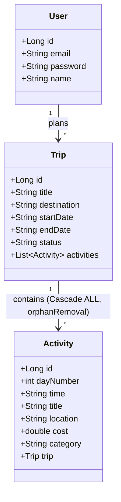

# TripMate Spring Boot & PostgreSQL Backend Architecture

This directory contains the Spring Boot 3.2 backend, JPA relational models, Spring Security configuration, and PostgreSQL database setup for **TripMate** (derived from [`travel_itinerary.zip`](file:///c:/Users/Joe/Projects/Trip%20Planner%20Wanderlog/travel_itinerary.zip)).

---

## 🏛️ Architecture Overview

The backend acts as an enterprise RESTful data service running on port `8080`, connected to a relational **PostgreSQL 16** database running on standard port `5432`.



---

## 🔌 REST API Endpoints Specification

Base URL: `http://localhost:8080/api`

### 1. Trips Management (`TripController.java`)

| HTTP Method | Endpoint | Description | Request Body | Response |
| :--- | :--- | :--- | :--- | :--- |
| `GET` | `/api/trips` | Retrieve all saved trips and their nested activities. | *None* | `200 OK` (Array of `Trip` objects) |
| `GET` | `/api/trips/{id}` | Retrieve a single trip by ID. | *None* | `200 OK` (`Trip`) or `404 Not Found` |
| `POST` | `/api/trips` | Create a new trip. | `{"title":"...", "destination":"...", "startDate":"...", "endDate":"...", "status":"Active"}` | `201 Created` / `200 OK` (`Trip`) |
| `DELETE` | `/api/trips/{id}` | Delete trip and automatically cascade delete all associated activities. | *None* | `200 OK` / `204 No Content` |

### 2. Activities & Expense Cascades (`TripController.java`)

| HTTP Method | Endpoint | Description | Request Body | Response |
| :--- | :--- | :--- | :--- | :--- |
| `POST` | `/api/trips/{tripId}/activities` | Add an activity / expense to a trip. | `{"dayNumber": 1, "time":"10:00 AM", "title":"...", "location":"...", "cost": 25.0, "category":"Sightseeing"}` | `200 OK` (Updated `Trip` object) |
| `DELETE` | `/api/trips/{tripId}/activities/{actId}` | Remove an activity from a trip. | *None* | `200 OK` (Updated `Trip` object) |

### 3. Real-Time Weather Proxy (`WeatherController.java`)

| HTTP Method | Endpoint | Description | Query Parameters | Response |
| :--- | :--- | :--- | :--- | :--- |
| `GET` | `/api/weather` | Proxies live OpenWeatherMap forecast data with URL encoding. | `city` (e.g. `?city=Zurich` or `?city=New+York`) | `200 OK` (OpenWeatherMap JSON Payload) |

---

## 🔒 Security & CORS Configuration

Defined in [`SecurityConfig.java`](file:///c:/Users/Joe/Projects/Trip%20Planner%20Wanderlog/travel_itinerary_backend/Travel%20Itinerary%20app%20-%20Copy/Backend/src/main/java/com/travel/itinerary/config/SecurityConfig.java):

```java
@Configuration
@EnableWebSecurity
public class SecurityConfig {

    @Bean
    public SecurityFilterChain securityFilterChain(HttpSecurity http) throws Exception {
        http
            .cors(cors -> cors.configurationSource(corsConfigurationSource()))
            .csrf(csrf -> csrf.disable())
            .authorizeHttpRequests(auth -> auth
                .requestMatchers(HttpMethod.OPTIONS, "/**").permitAll()
                .requestMatchers("/api/**").permitAll()
                .anyRequest().authenticated()
            );
        return http.build();
    }

    @Bean
    public CorsConfigurationSource corsConfigurationSource() {
        CorsConfiguration config = new CorsConfiguration();
        config.setAllowedOrigins(List.of("http://localhost:5173", "http://localhost:3000"));
        config.setAllowedMethods(List.of("GET", "POST", "PUT", "DELETE", "OPTIONS"));
        config.setAllowedHeaders(List.of("*"));
        config.setAllowCredentials(true);
        ...
    }
}
```

---

## 🐘 Database Configuration (`application.properties`)

File: [`src/main/resources/application.properties`](file:///c:/Users/Joe/Projects/Trip%20Planner%20Wanderlog/backend/src/main/resources/application.properties)

```properties
spring.application.name=itinerary
server.port=8080

# PostgreSQL Relational Datasource
spring.datasource.url=jdbc:postgresql://localhost:5432/travel_itinerary
spring.datasource.username=postgres
spring.datasource.password=root
spring.datasource.driver-class-name=org.postgresql.Driver

# Hibernate & JPA Automatic Schema Management
spring.jpa.hibernate.ddl-auto=update
spring.jpa.show-sql=true
spring.jpa.properties.hibernate.format_sql=true
spring.jpa.properties.hibernate.dialect=org.hibernate.dialect.PostgreSQLDialect
```

---

## 🚀 Build & Execution Instructions

### Prerequisites
- **JDK 17+**
- **Apache Maven 3.8+**
- **PostgreSQL 16** (running on port 5432 with database `travel_itinerary`)

### Compile and Start Backend
```powershell
# Navigate to the backend directory
cd backend

# Compile and run via Spring Boot Maven plugin
mvn clean spring-boot:run
```

Once started, the backend server will listen on `http://localhost:8080`.
The React frontend at `http://localhost:5173` will immediately discover and connect to the active backend.
